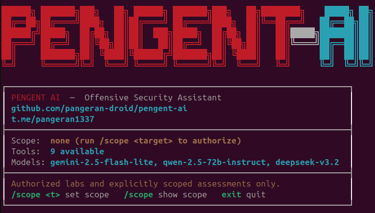
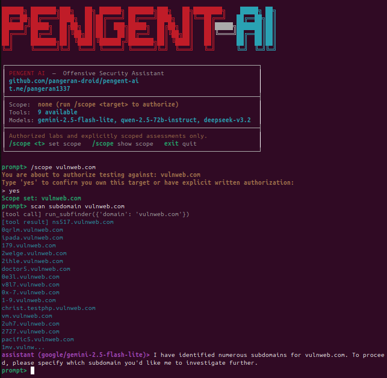

<h1 align="center">PENGENT AI</h1>

<p align="center">
  
</p>

<p align="center">
  <a href="https://www.python.org/"></a>
  <a href="https://openrouter.ai/"></a>
  <a href="LICENSE"></a>
  
  
</p>

<p align="center">PENGENT AI is a Python CLI agent for offensive security recon and validation, built on OpenRouter. Unlike a plain chatbot, it can actually <strong>execute</strong> read-only recon tools (subdomain enumeration, DNS resolution, HTTP probing, fuzzing, parameter discovery) against a target, read the real results, and reason from live data instead of guessing from text patterns alone.</p>

<p align="center">Every tool call is checked against an explicit, user-confirmed scope before it runs. The default prompt is designed for offensive security analysis, red teaming, and penetration testing in laboratories or environments with explicit authorization. Only use it for systems you own or assessments covered by written permission.</p>

## Preview

<p align="center">
  
</p>

## Why This Exists

Most "AI pentester" scripts are just a system prompt wrapped around a chat API — the model can *talk about* running `subfinder`, but it never actually runs it, and every "finding" is a guess shaped by training data, not observation. PENGENT AI closes that gap with a small, deliberately limited tool-calling layer:

- The model can call real tools and read real output.
- Every tool call is checked against an explicit scope before it executes — nothing fires against a target you haven't authorized in the current session.
- The tool set is read-only / non-destructive by design (enumeration, probing, fuzzing with filtered status codes, info-level scanning). Exploitation, payload delivery, and state-changing requests are intentionally **not** exposed as callable tools — the model can still explain a PoC concept in text, but it can't auto-fire it.
- The model is instructed to separate what it **verified with a tool call** from what remains a **hypothesis pending manual testing**, which is the main defense against confident-sounding hallucination.

## Features

- Interactive CLI with real-time streaming for plain conversation, and a tool-calling loop for anything that needs live data.
- **Explicit scope management** (`/scope`) — targets must be confirmed by the user before any tool is allowed to run against them.
- **9 built-in recon/validation tools** (see table below), each scope-checked, timeboxed, and output-truncated so a single call can't blow up the context window or hang the session.
- Automatic fallback to the next model in the chain on quota limits, rate limits, timeouts, network errors, or other retryable API failures.
- Output structured around attack vector, attack path, PoC concept, impact, and countermeasures — with an explicit note on what was tool-verified vs. hypothesized.
- A status banner that reflects the session's live state (current scope, tool count, active models) instead of a static splash screen.

## Tools

| Tool | What it does | Notes |
|---|---|---|
| `run_subfinder` | Passive subdomain enumeration | — |
| `run_dnsx` | Resolves hostnames to current A/CNAME records | Use to confirm dangling CNAMEs before claiming a takeover |
| `run_httpx` | Probes hosts for liveness, status, title, tech stack | — |
| `run_gau` | Passive historical URL collection from web archives | Never touches the live target |
| `run_nuclei` | Template scanning | **info/low/medium only** — high/critical severities are blocked at the executor level regardless of what the model requests |
| `run_ffuf` | Content/parameter fuzzing (`FUZZ` placeholder) | Wordlist must be one of a fixed whitelist; auto-calibration (`-ac`) always on; rate- and time-capped |
| `run_arjun` | Hidden GET parameter discovery | GET only |
| `http_request` | Single `GET`/`HEAD`/`OPTIONS` request to inspect headers/behavior | No state-changing methods — this is observation, not exploitation |
| `read_source_file` | Reads a local file for static analysis | Restricted to the project root; path traversal is blocked |

Required binaries on `PATH`: `subfinder`, `dnsx`, `httpx`, `gau`, `nuclei`, `ffuf`, `arjun`, `curl`. A tool fails gracefully with a clear error if its binary isn't installed — it won't crash the session.

## Technology

- Python 3.12
- [httpx](https://www.python-httpx.org/)
- [OpenRouter API](https://openrouter.ai/) (OpenAI-compatible `tools`/`tool_calls` format)

## Requirements

- Python 3.10 or newer
- Internet access
- OpenRouter API key
- `httpx` Python package
- ProjectDiscovery tools (`subfinder`, `dnsx`, `httpx`, `nuclei`) and `ffuf`, `arjun`, `gau` for the full tool set — the CLI still runs without them, but any tool call that needs a missing binary will return an error instead of a result

Python 3.12 is recommended because the current project environment uses Python 3.12.

## Installation

### 1. Clone the project

```bash
git clone https://github.com/pangeran-droid/pengent-ai.git
cd pengent-ai
```

### 2. Create a virtual environment

```bash
python3 -m venv env
source env/bin/activate
```

If the `env/` virtual environment already exists:

```bash
source env/bin/activate
```

### 3. Install Python dependencies

```bash
pip install httpx
```

### 4. Install recon tool binaries (optional but recommended)

```bash
# ProjectDiscovery suite
go install -v github.com/projectdiscovery/subfinder/v2/cmd/subfinder@latest
go install -v github.com/projectdiscovery/dnsx/cmd/dnsx@latest
go install -v github.com/projectdiscovery/httpx/cmd/httpx@latest
go install -v github.com/projectdiscovery/nuclei/v3/cmd/nuclei@latest

# Fuzzing / param discovery / URL collection
go install -v github.com/ffuf/ffuf/v2@latest
pip install arjun
go install -v github.com/lc/gau/v2/cmd/gau@latest
```

Any tool whose binary isn't installed will simply return an error when the model tries to call it — the rest of the CLI keeps working.

## API Key Configuration

The application reads the API key from the `OPENROUTER_API_KEY` environment variable.

Linux or macOS:

```bash
export OPENROUTER_API_KEY="your-openrouter-api-key"
```

Windows PowerShell:

```powershell
$env:OPENROUTER_API_KEY="your-openrouter-api-key"
```

To set the key permanently in Linux, add it to `~/.bashrc` or `~/.zshrc`:

```bash
export OPENROUTER_API_KEY="your-openrouter-api-key"
```

Do not commit API keys to source control.

## Running the Application

```bash
source env/bin/activate
export OPENROUTER_API_KEY="your-openrouter-api-key"
python main.py
```

### Setting scope

No tool will run against a target until you explicitly authorize it for the session:

```text
prompt> /scope vulnweb.com
You are about to authorize testing against: vulnweb.com
Type 'yes' to confirm you own this target or have explicit written authorization:
> yes
Scope set: vulnweb.com
```

Check the current scope at any time:

```text
prompt> /scope
Current scope: ['vulnweb.com']
```

Scope is session-only — it resets every time you restart the process. You can authorize multiple domains/IPs/CIDRs at once, comma- or space-separated: `/scope example.com, 10.0.0.0/24`.

### Example interaction

```text
prompt> scan subdomain vulnweb.com
[tool call] run_subfinder({'domain': 'vulnweb.com'})
[tool result] 2o67.vulnweb.com
cygnus.vulnweb.com
bailando1.vulnweb.com
...
assistant (google/gemini-2.5-flash-lite)> Found several subdomains for vulnweb.com.
Want me to probe them for liveness and tech stack next?
prompt> exit
```

Type `exit`, press `Ctrl+C`, or end input with `Ctrl+D` to quit.

## AI Models

Tool calling requires models with reliable OpenAI-style function-calling support. Only these are used in the tool-calling chain:

1. `google/gemini-2.5-flash-lite`
2. `qwen/qwen-2.5-72b-instruct`
3. `deepseek/deepseek-v3.2`

> `google/gemma-4-*` variants are intentionally excluded from this list — their tool-calling support via OpenRouter is inconsistent at the time of writing. Verify manually before adding any new model to the chain.

Fallback to the next model in the list happens on retryable errors, including:

- HTTP 402, 408, 429, 500, 502, 503, or 504
- Quota or credit exhaustion
- Rate limits
- Network or timeout errors
- Streams that end before `[DONE]`
- Temporarily unavailable or overloaded models

## How Tool Calling Works

1. Your message is sent to the model along with the full tool schema (`tools/schema.py`).
2. If the model decides it needs live data, it returns a `tool_calls` request instead of text.
3. The executor (`tools/executor.py`) checks the target against the current scope, then runs the tool with a hard timeout and truncates oversized output.
4. The tool's result is fed back to the model as a `tool` message.
5. This repeats (up to 6 rounds per turn) until the model produces a final text answer.

Scope state is re-injected into the system prompt on **every turn** — not just read once at startup — so the model always knows what's currently authorized, even across a long conversation.

## Response Format

For offensive security analysis requests, the prompt directs the model to use this format:

1. **Target & Attack Vector**
2. **Attack Path**
3. **PoC Concept** — notes which parts were tool-verified vs. proposed for manual testing
4. **Compromise Impact**
5. **Countermeasures**

PoCs are limited to safe evidence: pseudo-code, restricted requests, or validation using test data. The tool layer physically cannot fire exploits (no POST/PUT/DELETE, no high/critical nuclei templates) — anything beyond observation stays as a text-described concept for you to verify manually.

## Conversation History

History is kept only in memory while the Python process is running. It is discarded when the application exits and is not written to disk.

The application sends at most the latest 20 messages in one request to limit context size:

```python
messages_to_send = system + temp_history[-20:]
```

History includes user messages, assistant responses, tool-call requests, and tool results.

## Project Structure

```
pengent-ai/
├── main.py                   # CLI loop, tool-calling orchestration, scope commands
├── system/
│   └── system_prompt.txt     # Role, methodology, safety boundaries, tool usage rules
├── tools/
│   ├── __init__.py
│   ├── guardrail.py          # ScopeManager — validates targets before any tool runs
│   ├── schema.py             # Tool definitions sent to the model (OpenAI tools format)
│   ├── executor.py           # Actual subprocess/HTTP execution for each tool
│   └── wordlists/            # Fixed, whitelisted wordlists for run_ffuf
├── LICENSE
└── README.md
```

## Safe Usage

Use PENGENT AI only for:

- Local labs or sandbox environments
- Applications you own
- Authorized CTF challenges
- Penetration tests with rules of engagement
- Vulnerability validation within a written scope

Do not use it for:

- Attacking systems or people without permission
- Malware, ransomware, cryptominers, or backdoors
- Persistence or defense evasion on real targets
- Impact escalation that is unnecessary to prove a vulnerability
- Data exfiltration or service disruption outside the agreed scope

`/scope` confirmation is a safety net against the AI silently pivoting to an unauthorized host — it is **not** a substitute for actual legal authorization. You are responsible for verifying you have the right to test any target before typing `yes`.

## Known Limitations

- Tool calling reliability depends on the upstream model/provider — small or cheap models can occasionally hallucinate a refusal or misformat arguments even with everything configured correctly. Treat tool output as ground truth; treat the model's narration around it with normal skepticism.
- No persistent audit log yet — scope changes and tool calls are only visible in the live terminal session, not written to a file.
- No chaining logic (IDOR→auth bypass, SSRF→cloud metadata, etc.) is automated. The model can discuss these chains, but executing and correlating them across multiple tool calls is still on you.
- Wordlists shipped under `tools/wordlists/` are small starter lists — swap in SecLists or your own for serious fuzzing.

## Roadmap Ideas

- [ ] Persistent session logging (target, tool, timestamp, result hash)
- [ ] Optional authenticated `http_request` variant with a strict, user-approved header/cookie allowlist
- [ ] Pluggable wordlist sources (SecLists path config instead of bundled lists)
- [ ] A-to-B finding correlation assist, based on the known chain patterns in the bug bounty methodology

## Contributing

1. Create a separate branch for changes.
2. Keep prompts focused on authorization and safe validation.
3. Any new tool must go through the same pattern: scope check → timeout → output truncation → whitelisted inputs (no arbitrary file paths, no unbounded severities, no state-changing HTTP methods).
4. Run `python -m py_compile main.py tools/*.py` before committing.
5. Ensure API keys or secrets are not included in the diff.
6. Document changes to models, prompts, tools, or configuration in this README.

## License

[MIT](LICENSE)